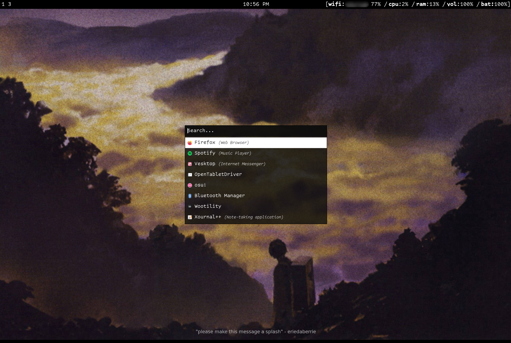
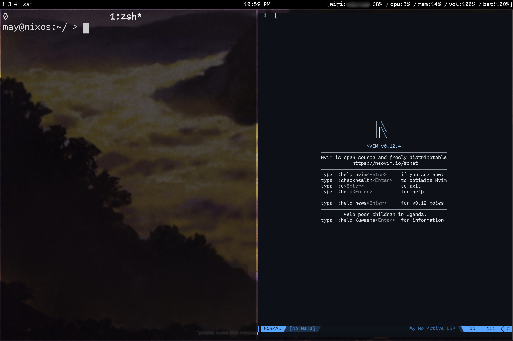

check out my dotfiles...

---

Here's an overview of what's in my setup. Configs for each are included in this
repo.

- [**nix**](https://github.com/NixOS/nixpkgs): the linux distro I use
- [**hyprland**](https://github.com/hyprwm/Hyprland): dynamic tiling Wayland
  compositor
- [**waybar**](https://github.com/Alexays/Waybar): status bar
- [**rofi**](https://github.com/davatorium/rofi): application launcher
- [**kitty**](https://github.com/kovidgoyal/kitty): terminal emulator
- [**nvf**](https://github.com/NotAShelf/nvf): manages my
  [neovim](https://github.com/neovim/neovim) configuration
- [**zsh**](https://github.com/zsh-users/zsh): shell
- the best fonts (Comic Code, JetBrainsMono)

